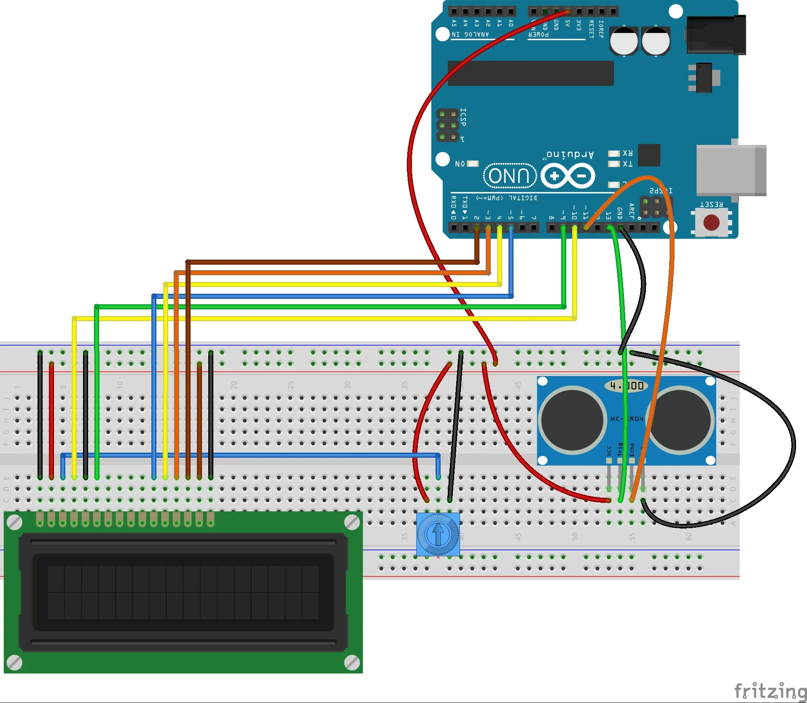

# Sense and Respond
# 1. System purpose

- **Problem and real-world context:**when your backing up and having a sensor tell you how close you are to the wall
- **Intended user:** The intended users are people who are backing up into there homes.
- **What physical condition should your system monitor?** The distance you are forme the wall.
- **How will the system's response help the user?** it will alert the user to how far a way they are from there wall.

## 2. System design

### System diagram


```text
Inputs distance  → Processing has it gone past a suntan number→ Outputs a warning level 
```

### Inputs and outputs


| Device | Input or output | Arduino pin(s) | Analog or digital?  |
| --- | --- | --- | --- |
| sounds input | Sensor input | TODO | TODO |
| LCD | Output | TODO | TODO |
| sounds beeper | Additional output | TODO | TODO |

### Decision table


| Sensor reading or condition | System state | LCD display | Additional output |
| --- | --- | --- | --- |
| sound | normal | safe |NA |
| sound| slow down | slow down | one beep |
| sound| stop |stop |long beep |


## 3. Circuit design




## 4. Testing and revision


| Test | Condition or sensor reading | Expected response | Actual response |
| --- | --- | --- | --- |
| Normal operation | 36 inches | print safe | printed safe |
| Condition that triggers a response | past 36 inches | slow down | slow down |
| Condition that triggers a response | 10 or less inches |STOP | STOP |

**Revisions made to the system based on testing**
nothing 

**Revision and reason:** none

**Result after testing the revision:** none

## 5. Video Demonstration


[Video demonstration](https://youtube.com/)
